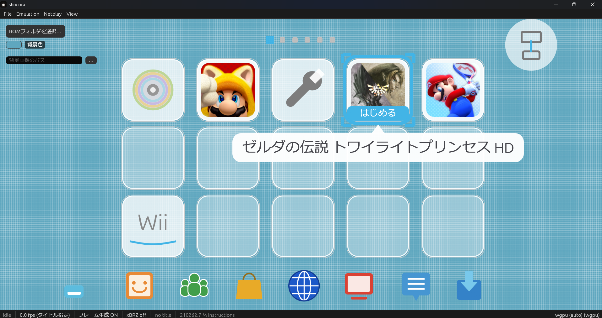

# shocora

<p align="center">
  
</p>

Wii U emulator written in Rust, structured after the hardware and system
software of the console. Its design references [Cemu](https://github.com/cemu-project/Cemu).

## Images

<p align="center">
  
</p>
<p align="center">
  
</p>
<p align="center">
  
</p>

## Quick Start

```text
cargo xtask run [--graphics wgpu|vulkan|opengl] [-- TITLE_DIR | FILE.rpx]
cargo xtask test
cargo xtask icon   # gui/egui/assets/shocora.svg -> shocora.png, shocora.ico
```

## Features & Configuration Guide

### 🎨 Graphics & Display

- **Graphics Backends**:
  - `wgpu` (default): Automatically selects the best backend (DX12 / Metal / Vulkan / GL).
  - `vulkan`: Forces wgpu's Vulkan backend.
  - `opengl`: Uses native OpenGL through `glow`.
- **3D Resolution**: Scalable from **2x to 8x** (up to 10,240 pixels wide).
  - *Examples*: 8x at 720p, 5x at 1080p.
  - *Note*: Significantly increases VRAM usage.
- **Screen Upscaling**: Runs xBRZ on the GPU at **2x to 6x**.
  - Included under the default `xbrz` feature of `shocora_render` (GPL-3.0 licensed).
- **Frame Rate Control**:
  - **Force 60 fps**: Overrides the title's native swap interval.
    - *Warning*: Titles logic-bound to 30 fps (e.g., *Twilight Princess HD*) will run up to double speed.
  - **Default**: Preserves the target frame rate requested by the title.
  - **Max 30 fps**: Caps titles that run excessively fast while leaving slower ones untouched.

---

### 🎮 Controls & Input

#### Default Keybindings

| Action / Button     | Keyboard Key                 |
| :------------------ | :--------------------------- |
| **A / B / X / Y**   | `X` / `Z` / `S` / `A`        |
| **L / R / ZL / ZR** | `Q` / `W` / `1` / `2`        |
| **+ / −**           | `Enter` / `Backspace`        |
| **D-Pad**           | Arrow Keys (`↑` `↓` `←` `→`) |
| **Left Stick**      | `I` `J` `K` `L`              |

#### Controller & Hotkeys

- **Gamepad Support**: Powered by [gilrs](https://gitlab.com/gilrs-project/gilrs) with plug-and-play functionality.
  - Mapped by physical button position (`East` corresponds to the Wii U's **A** button).
  - Custom mappings can be configured under `[pad_bindings]` in `shocora.toml`.
- **Game Speed Toggle**: Cycle through speeds (`1x` → `2x` → `3x` → `4x` → `0.5x`) using `Tab`, pressing the Left Stick, or clicking the speed indicator on the status bar.
  - Audio pitch dynamically scales with speed (tape-style playback).
  - *Note*: Pressing the Left Stick to change speed prevents the input from reaching the game.

---

### 📂 Setup & File Structure

- **Configuration File**: Settings are saved in `shocora.toml` within the working directory.
- **ROM Directory Management**: Listed in `roms.json` (git-ignored; template available as `roms.example.json`).
  - Supports extracted titles (`<name>/code`, `content`, `meta`) and `.rpx` files.
  - Detected games appear in the **Games** panel; double-click to boot.
- **Shader Cache**: Compiled GPU shaders are saved in `shader_cache/` to minimize stuttering on subsequent runs.
- **Localization**: Change languages in **Settings > General**.
  - Built-in translations: `lang/translation.eng.json` and `lang/translation.jpn.json`.
  - Placing a custom `lang` folder in the working directory takes precedence, allowing translation edits without rebuilding.

---

### 🌐 Local Network Netplay

Allows a second player to join via local network.

- **Host Setup**: Enter the host PC's IP address (e.g., `192.168.1.10` or `10.1.2.3/16` for wider subnets) and host on port `47800`.
  - Access is limited to guests within the specified network.
  - Password protection is optional.
- **Guest Experience**: Connect to the host's IP to play as a **Pro Controller**.
  - **Video**: 640 × 360 resolution at 20 fps.
  - **Audio**: 16 kHz stream.
- **Connection Handling**: Ping checks occur once per second. If no response is received for 3 seconds, the connection closes and the guest continuously attempts reconnection.
- **Security Warning**: While passwords are not sent in plain text, network traffic is **unencrypted**. Only use Netplay on trusted networks.

---

### 🛠 Debugging

Run headless boots for debugging via command line:

```bash
cargo run --release -p shocora_tests --example headless -- <TITLE_DIR> [FRAMES]
```

## References

- [docs/ref-wiiubrew](docs/ref-wiiubrew/01_emulator_architecture.md)
- [Wii U Architecture](https://www.copetti.org/writings/consoles/wiiu/)
- [Wii U Home Brew](https://wiiubrew.org/wiki/Main_Page)
- [Cemu](https://github.com/cemu-project/Cemu): Wii U Emulator written in  C++

## License

SPDX-FileCopyrightText: (C) 2026 Cemu Project
SPDX-License-Identifier: MPL-2.0
