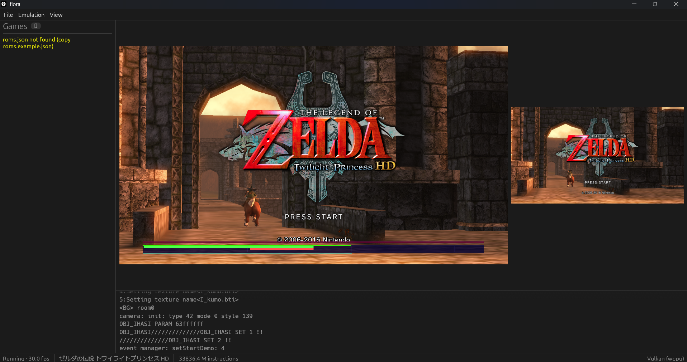
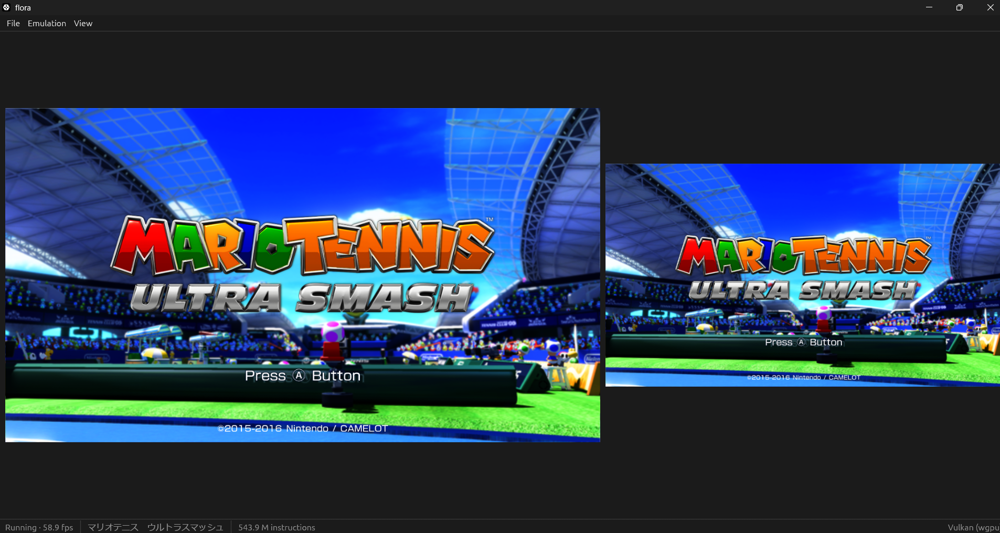

# flora

Wii U emulator written in Rust, structured after the hardware and system
software of the console. Its design references [Cemu](https://github.com/cemu-project/Cemu).

<p align="center">
  
</p>
<p align="center">
  
</p>

## Quick Start

```text
cargo xtask run [--graphics wgpu|vulkan|opengl] [-- TITLE_DIR | FILE.rpx]
cargo xtask test
```

- `wgpu` picks the best backend (DX12 / Metal / Vulkan / GL), `vulkan` forces
  wgpu's Vulkan backend, `opengl` uses native OpenGL through glow.
- Settings are stored in `flora.toml` in the working directory.
- ROM directories are listed in `roms.json` (git-ignored; copy
  `roms.example.json`). Each directory may hold extracted titles
  (`<name>/code`, `content`, `meta`) and `.rpx` files; they appear in the
  "Games" panel, double-click to boot.
- Headless boot for debugging:
  `cargo run --release -p flora_tests --example headless -- <TITLE_DIR> [FRAMES]`
- Default keys: A=`X` B=`Z` X=`S` Y=`A` L=`Q` R=`W` ZL=`1` ZR=`2`
  +=`Enter` −=`Backspace` D-pad=arrows, left stick=`IJKL`.
- Controllers work through [gilrs](https://gitlab.com/gilrs-project/gilrs) as soon as they
  are plugged in; buttons go by position (`East` is the Wii U's A). `[pad_bindings]` in
  `flora.toml` changes the mapping.
- View > Screen upscaling runs xBRZ on the GPU at 2x to 6x. It is GPL-3.0 code behind
  the default `xbrz` feature of `flora_render`.
- View > Frame rate > Force 60 fps replaces the title's swap interval. Titles made for
  30 fps whose logic counts frames, such as Twilight Princess HD, then run at up to
  double speed; the default keeps the frame rate the title asks for.
- The driver's compiled shaders are kept in `shader_cache/`, so later runs stutter less.

See [docs/ref-wiiubrew](docs/ref-wiiubrew/01_emulator_architecture.md) for the
architecture and status.

## License

MPL-2.0
